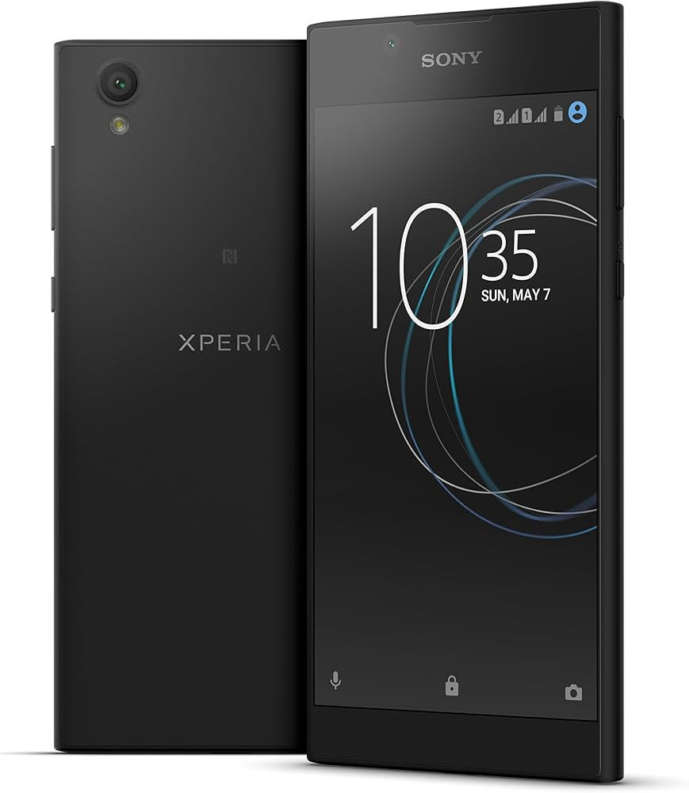

# Sony-Xperia-L1-Optimizing



## What Is Sony Xperia L1?

* Sony Xperia L1 is an entry-level Android smartphone manufactured by Sony Mobile Communications. It was announced in March 2017 and released in June 2017 as a successor to the Xperia E5.

**Features**

• Display: 5.5-inch IPS LCD, HD (1280 x 720 pixels) resolution

• Processor: MediaTek MT6737T quad-core 1.45 GHz

• RAM & Storage: 2 GB RAM and 16 GB internal storage (expandable up to 256 GB via microSDXC)

• Rear Camera: 13 MP (f/2.2) with autofocus and LED flash

• Front Camera: 5 MP (f/2.2)

• Battery: 2620 mAh with Qnovo adaptive charging

• Operating System: Android 7.0 "Nougat"

• Connectivity: USB Type-C, Wi-Fi, Bluetooth 4.2/5.0, NFC, and a 3.5mm headphone jack

• Build: Polycarbonate plastic shell, available in colors like Black, White, and Pink

## How we can try to **Optimize** it?

• Putting Custom ROM's on it

• Remove the bloatware (Google, GMS, Sony Mobile Bloatware... And More)

## How we will manage to upload Custom ROM on it?

• Before uploading a Custom ROM on it we'll have to Unlock the Bootloader

## How to unlock Bootloader?

• Check Eligibility

**Before starting, you must ensure your specific Xperia L1 variant allows bootloader unlocking (some carrier-locked models restrict it).**

1. On your Xperia L1, open the phone dialer and enter 
```bash
*#*#7378423#*#*
```

2. In the service menu that appears, navigate to Service info > Configuration > Rooting Status.

3. Look for Bootloader unlock allowed:

   • If it says Yes, you can proceed.
   
   • If it says No or is missing, your bootloader cannot be unlocked. (You Will Can **Not** proceed onto Custom ROM or Rooting it)


• Get Your Official Unlock Code

1. Get your phone's IMEI number by dialing *#06# and writing it down.

2. Visit the Sony Developer World Bootloader Site.

3. Select Sony Xperia L1 from the list of supported devices.

4. Enter your email and your IMEI number.

	• Note: If the site gives an error about length, remove the very last digit of your IMEI and try again.
	
5. Submit the request, and Sony will generate a unique Unlock Key. Write this key down safely.


• Prepare the PC & Environment

1. Back up all important files on your phone, as they will be deleted.

2. Download the Android SDK Platform-Tools (ADB & Fastboot) from here [SDK PTools](https://developer.android.com/tools/releases/platform-tools).

3. Extract the downloaded folder to an accessible location on your PC (e.g., C:\platform-tools).


• Run the Commands

1. Power off your Xperia L1 completely.

2. Press and hold the Volume Up button, and while holding it, connect the phone to your computer using a USB cable. The phone’s LED should turn blue, indicating it is in Fastboot Mode.

3. On your computer, open a Command Prompt (cmd) windows inside your platform-tools folder (Hold Shift + Right-click inside the folder and select "Open command window here", or type cd C:\platform-tools in cmd).

4. Test the connection by typing:
```bash
fastboot devices
```

If a string of numbers appears, your PC successfully detects the device.

5. Execute the final unlock command using the key you received from Sony:
```bash
fastboot -i 0x0fce oem unlock 0xYOUR_UNLOCK_KEY
```

(Replace YOUR_UNLOCK_KEY with the exact code provided by Sony's website).
6. Once the terminal confirms the process is finished, type:
```bash
fastboot reboot
```

Your Xperia L1 will reboot and perform a factory reset, after which its bootloader will be fully unlocked. over there you should do a Quick setup.

• Getting Files

ROM: [XDA LOS 14.1](https://xdaforums.com/t/rom-lineageos-14-1-for-sony-xperia-l1-aka-pine.4053193/)

TWRP: [XDA TWRP](https://xdaforums.com/t/recovery-release-working-twrp-for-sony-l1-g3311-single-sim-others-to-be-confirmed.3818260/)

* LineageOS 14.1 on the Community is Your **Safest Bet on Custom ROM** from on **ROM** Link i gaved get Magisk **If GAPPS option malfunctions** Please look at the below link

GAPPS: [OpenGAPPS](https://opengapps.org/)

• How To Use OpenGAPPS website?

For Sony L1 you'll have to click these:

• Platform: ARM64

• Android: 7.1

• Variant: I Prefer Pico or Nano Micro Mini if you want full Google Apps youll have to click FULL.
```bash
Info: if you will go with FULL please be Cautious Device can get hot.
```
TWRP:

before making one mistake lets take our TWRP image to our SDK Platform Tools Folder

after that go to the SDK Platform tools we extracted and added TWRP.img and then typed cmd in it type:
```bash
fastboot flash boot v5-twrp-l1.img
```

After that reboot your phone it should boot to TWRP

Over there press on to Wipe>Advanced Wipe and select only these **System/Cache/ART Cache Dalvik/Data/Internal Storage** if it cannot RW your storage press on to **Format Data** and type **YES** and then get to main menu press on Reboot>Recovery

If the phone says **Cannot boot into Recovery. Image is corrupted Dont worry it shall close itself then press and hold Power it should Boot into TWRP again over there do the first step Wipe>Advanced Wipe

After that it should say System cannot be deleted after Phone says that go back Wipe>Format Data then Type **YES** then go back to main menu Reboot>Recovery if it says Cannot boot into Recovery Image is Corrupt dont worry it shall close itself press and hold Power Button it shall boot into TWRP

Then Press into Install Below for more better flashing:

• Without Magisk only GAPPS

1. Flash LOS14.1.zip

2. Flash GAPPS.zip

3. Wipe ART/Dalvik

4. Press Reboot>System

5. It Can Take Long to boot...

• Without GAPPS only Magisk

1. Flash LOS14.1.zip

2. Flash Magisk.zip

3. Wipe ART/Dalvik

4. Press Reboot>System

5. It Can Take Long to boot...

• All Contained

1. Flash LOS14.1.zip

2. Flash GAPPS.zip

3. Flash Magisk.zip

4. Wipe ART/Dalvik

5. It Can Take Long to boot...
